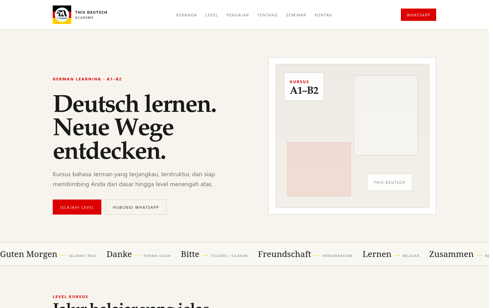
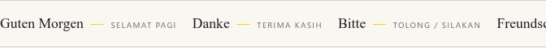
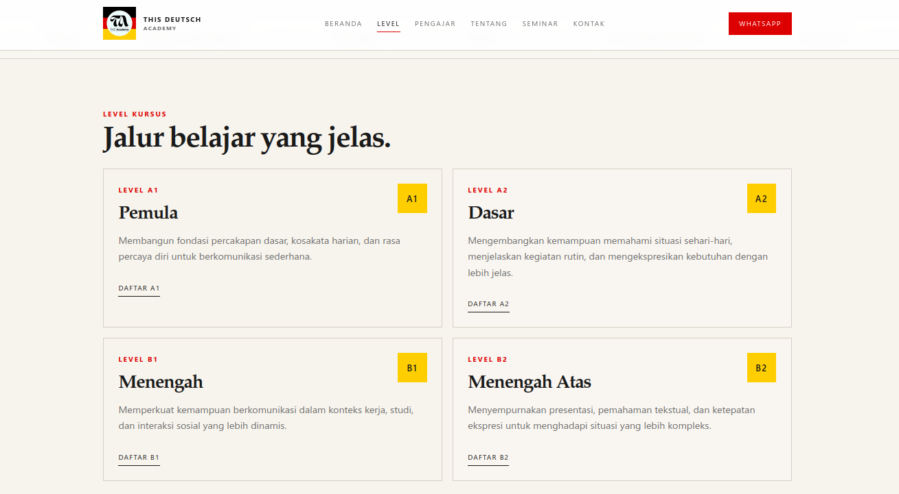
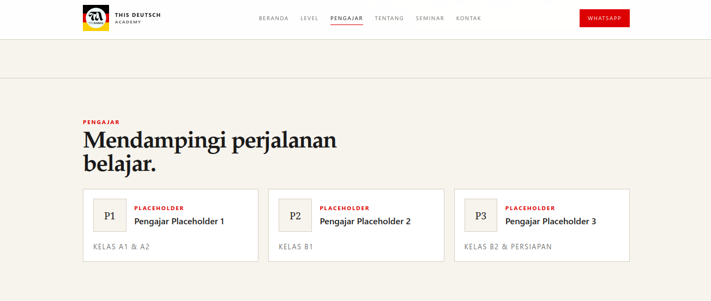
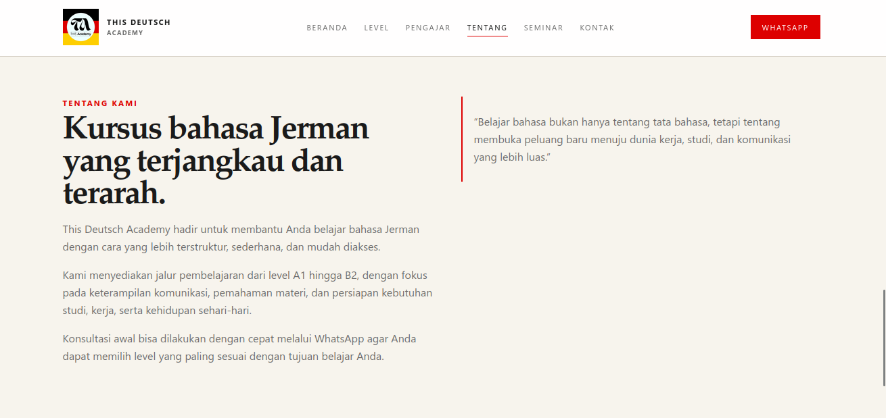
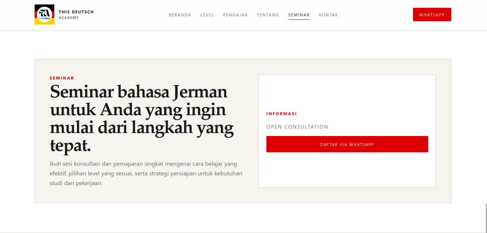
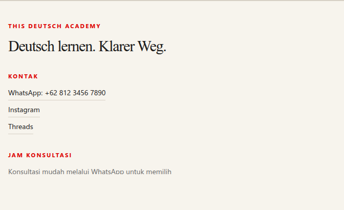
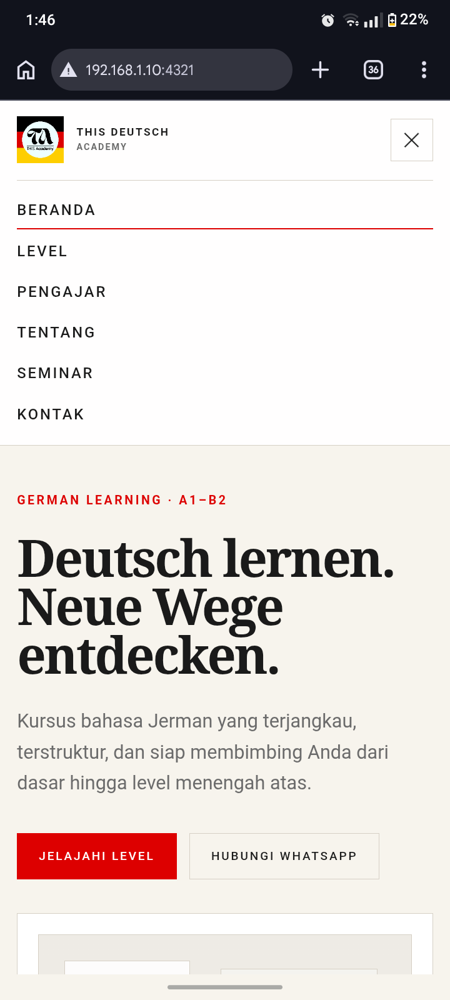

<div align="center">

# This Deutsch Academy

An editorial landing page for a German language academy, designed to guide Indonesian learners through German courses from A1 to B2.

<p>
  <a href="https://astro.build/"></a>
  <a href="https://www.typescriptlang.org/"></a>
  <a href="https://tailwindcss.com/"></a>
</p>

[Website sections](#website-preview) · [Getting started](#getting-started) · [Project structure](#project-structure)

</div>

## Contents

- [Overview](#overview)
- [Website preview](#website-preview)
- [Tech stack](#tech-stack)
- [Design highlights](#design-highlights)
- [Accessibility and responsive design](#accessibility-and-responsive-design)
- [Project structure](#project-structure)
- [Getting started](#getting-started)
- [License and credits](#license-and-credits)

## Overview

This Deutsch Academy is a single-page website for a German language academy. It introduces the academy, presents its A1–B2 learning pathway, and connects prospective learners with the academy through WhatsApp and social links.

The page includes:

- An editorial hero and responsive navigation.
- A continuously scrolling German vocabulary strip with Indonesian translations.
- Course information for A1, A2, B1, and B2, with level-specific WhatsApp registration messages.
- Three teacher placeholder profiles.
- Academy information, a seminar section, and contact links.
- Responsive desktop and mobile layouts.

## Website preview

The following images were captured from the built site running through Astro's production preview.

### Homepage

The hero introduces the academy and provides links to the course levels and WhatsApp consultation.



### German vocabulary marquee

German vocabulary and Indonesian translations scroll across the page in a repeating strip.



### Course levels

The course section presents the four available levels and their individual registration links.



### Instructors

An academic-directory-style section displays the three instructor placeholders and their assigned classes.



### About the academy

The about section describes the academy's course pathway and learning approach.



### Seminar

The seminar section includes an overview and a WhatsApp registration action.



### Contact and footer

The footer contains WhatsApp, Instagram, and Threads links.



### Mobile navigation

The mobile navigation opens from the hamburger button and provides the page's section links.



## Tech stack

| Technology                                  | Role                                                                            |
| ------------------------------------------- | ------------------------------------------------------------------------------- |
| [Astro](https://astro.build/)               | Static site rendering, page composition, and reusable `.astro` components       |
| TypeScript                                  | Type-annotated browser interactions in Astro scripts                            |
| [Tailwind CSS v4](https://tailwindcss.com/) | Utility styling, integrated through `@tailwindcss/vite`                         |
| CSS                                         | Shared design tokens, responsive rules, marquee animation, and menu transitions |
| Bun                                         | Dependency installation and project scripts                                     |

## Design highlights

- German flag-inspired charcoal, red, gold, ivory, and white palette.
- Serif display typography paired with restrained sans-serif labels.
- Swiss-inspired alignment, fine borders, and generous whitespace.
- Responsive navigation with a compact animated mobile menu.
- Repeating German vocabulary marquee with Indonesian translations.
- Smooth anchor scrolling and reduced-motion support.

## Accessibility and responsive design

The site uses semantic page sections, navigation labels, descriptive logo text, and an accessible mobile-menu button with synchronized `aria-expanded` and `aria-controls` attributes. The menu can be operated by keyboard, closes with Escape, and becomes inert when closed. Motion is reduced when the visitor has enabled the reduced-motion preference.

The layout and navigation adapt to smaller viewports. These implementations support accessibility, but do not represent a claim of complete accessibility conformance.

## Project structure

```text
this-deutsch-academy/
├── docs/
│   └── screenshots/       # Production-preview screenshots used in this README
├── public/                # Public favicon assets
├── src/
│   ├── assets/            # Academy logo and starter assets
│   ├── components/        # Header, footer, and Astro components
│   ├── layouts/           # Shared HTML document layout
│   ├── pages/             # Astro routes, including the home page
│   └── styles/            # Shared design tokens and global styles
├── astro.config.mjs       # Astro and Tailwind Vite integration
├── bun.lock               # Bun dependency lockfile
├── package.json           # Dependencies and scripts
└── tsconfig.json          # TypeScript configuration
```

## Getting started

### Requirements

- [Bun](https://bun.sh/) for installing dependencies and running the scripts.
- Node.js `>=22.23.4`, as specified by the project engine requirement.

### Install and run locally

```sh
git clone https://github.com/24-Muhammad-Ikhsan-X-PPLG-2/this-deutsch-academy.git
cd this-deutsch-academy
bun install
bun run dev
```

The development server prints its local URL when it starts.

### Build and preview

```sh
bun run build
bun run preview
```

The preview command serves the production build locally. The project does not require environment variables for the current website.
